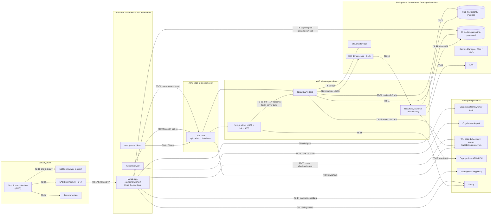

# Threat model — pilot baseline

| Field | Value |
| --- | --- |
| Assignment | R01-C — security and privacy baseline |
| Status | Draft baseline for human review. **Every control below is planned, not implemented.** No application, infrastructure, Cognito pool, queue, bucket, or Wix integration exists yet. |
| Inputs | `AGENTS.md`, `docs/architecture/system-architecture.md`, `docs/architecture/data-and-api-spec.md`, `docs/architecture/file-and-infrastructure-spec.md`, `docs/product/pilot-scope.md`, `docs/operations/configuration.md`, `docs/operations/github-setup.md`, `docs/prompts/round-01.md`…`round-16.md` at `main` commit `b616de8` |
| Companion documents | [`security-acceptance-tests.md`](./security-acceptance-tests.md) (testable requirements), [`../privacy/privacy-data-map.md`](../privacy/privacy-data-map.md) (data classification, retention, deletion ownership) |
| Change rule | This document does not change the architecture. Where it identifies a gap in the specification it records the gap in [§9](#9-specification-gaps-and-decisions-for-humans) for an ADR or human decision; it does not resolve it. |

## 1. Method

1. Enumerate assets, actors, and trust boundaries from the accepted specifications.
2. For each component in scope, list threats with a concrete abuse case (attacker, entry point, steps, impact). Threats are grouped STRIDE-style but labelled by what can actually go wrong.
3. Map each threat to the **planned controls** already required by the specifications, or to an explicitly labelled *additional recommendation* where the specifications are silent.
4. Map each threat to **security acceptance tests** (`SAT-*` IDs in `security-acceptance-tests.md`) and to the **future rounds** that implement or verify them (`docs/tasks/rounds.md`).
5. Rate residual risk *before* controls as **Critical**, **High**, **Medium**, or **Low** using impact (financial loss, physical-safety/privacy harm, account takeover, integrity of financial/audit records) and ease of exploitation.

Provider capabilities are treated as **unknown until proven**. In particular, nothing in this document asserts that Wix supports a given signature scheme, event type, ordering guarantee, reconciliation API, refund behavior, or sandbox. Those items are conditional on the R02-C spike and on a human-recorded `WIX_OK`.

## 2. Assets

| ID | Asset | Why it matters |
| --- | --- | --- |
| A1 | Customer precise service location (address and coordinates) | Reveals where a person lives; physical-safety and burglary risk. Highest-sensitivity personal data in the pilot. |
| A2 | Worker location data (service-area centre/radius, availability) | Service-area centres are frequently a worker's home. |
| A3 | Identity and contact data (email, phone, name, Cognito `sub`) | Account takeover, harassment, off-platform solicitation. |
| A4 | Authentication material (Cognito access/refresh/ID tokens, admin session cookie, admin Cognito client secret, session signing secret) | Direct account takeover. |
| A5 | Authorization state (roles, local admin permissions, account status, worker verification state) | Integrity of every access decision. |
| A6 | Job, quote, and booking records and their versions | Marketplace integrity; double bookings; price manipulation. |
| A7 | Payment state, provider correlation, refunds (post-`WIX_OK` only) | Direct financial loss; forged "paid" bookings. |
| A8 | Ledger transactions/postings and payout/settlement records | Financial integrity; duplicate worker settlement; fraud concealment. |
| A9 | Audit events | Ability to detect and investigate abuse; non-repudiation of admin actions. |
| A10 | Media (job photos, dispute evidence) and its metadata | Photos of homes, people, and EXIF GPS. |
| A11 | Notification device tokens and notification content | Spoofed/phishing pushes; content visible on lock screens. |
| A12 | Provider credentials (Wix API key, webhook verification material, Expo access token, SES, Sentry DSN, maps key, DB passwords) | Pivot into third-party accounts; forged events. |
| A13 | CI/CD and release integrity (GitHub branches, Actions, OIDC roles, ECR digests, EAS builds/OTA updates, Terraform state) | One compromise ships malicious code to every user and every environment. |
| A14 | Backups and logs (RDS snapshots, S3 object versions, CloudWatch, Sentry) | Copies of all of the above with weaker access paths and longer life. |

## 3. Actors

| ID | Actor | Capability assumed |
| --- | --- | --- |
| X1 | Anonymous internet attacker | Can reach the ALB (API, admin, links hosts) and `/v1/webhooks/*`; can sign up as a customer/worker in the customer/worker pool. |
| X2 | Malicious customer | Valid customer account; controls their own device and can replay or modify any request. |
| X3 | Malicious worker (verified or unverified) | Valid worker account; may hold opportunities/assignments; can call any API route directly. |
| X4 | Colluding customer + worker | Both sides of a booking, e.g. to fabricate completions, reviews, or disputes, or to farm refunds/payouts. |
| X5 | Curious or malicious administrator (insider) | Valid admin pool account with some subset of permissions; may try to exceed it or erase traces. |
| X6 | External attacker with a stolen admin credential or session | Phished password/TOTP, stolen cookie, or malicious browser extension. |
| X7 | Compromised or lost mobile device | Access to app storage, notifications on the lock screen, screenshots. |
| X8 | Compromised or misbehaving provider / network position | Forged or replayed webhooks, malformed provider responses, provider outage. |
| X9 | Supply-chain / CI attacker | Malicious dependency, compromised third-party GitHub Action, malicious PR content. |
| X10 | AI coding platform or contributor acting outside its lease | Has branch and PR write access by design (`docs/operations/github-setup.md`); may be steered by prompt injection in repository or PR content. |
| X11 | Holder of a leaked notification token or Expo credential | Can attempt to send or redirect pushes. |

## 4. Assumptions

1. Separate staging and production AWS accounts; nothing shared across environments (`file-and-infrastructure-spec.md` §3).
2. Customer/worker and admin identities live in **separate Cognito user pools**; admin self-sign-up is disabled and TOTP MFA is required.
3. The API and the queue worker run in private subnets; only the ALB is public. Admin and links hosts are served by the same Next.js service.
4. The browser and mobile app are fully attacker-controlled. Any value they send — amounts, roles, IDs, states, return-URL parameters, content types — is untrusted.
5. SQS delivery is at-least-once and unordered; Wix event delivery semantics are unknown until the spike.
6. Worker payouts are executed **outside** the system by a human; the system only records approvals, external references, and balanced ledger entries.
7. Exact location visibility, retention periods, refund policy, and dual-control thresholds are **human policy inputs** not yet decided (`pilot-scope.md`). Controls are written so the policy can be plugged in, and tests are written against the policy once it exists.
8. Test fixtures are synthetic; no test calls a live provider.

## 5. System and trust boundaries

| ID | Boundary | What crosses it | Must be enforced on the trusted side |
| --- | --- | --- | --- |
| TB-01 | Mobile/anonymous → API (via ALB) | Cognito access tokens, JSON bodies, `Idempotency-Key`, path IDs | Token verification (signature, `iss`, `client_id`, `exp`, `token_use=access`), local principal + account status, role/permission, ownership, DTO allowlists, server-derived amounts/states. |
| TB-02 | Admin browser → admin BFF | HttpOnly session cookie, form posts | Session integrity, CSRF defence, server-side permission check per route, allowlisted BFF paths, no admin token in browser JavaScript. |
| TB-03 | Anonymous → links host | `/.well-known/*`, `/open/*`, `/payments/wix/return` | Static/public content only; no secrets; no open redirect; return route displays neutral status and mutates nothing. |
| TB-04 | Mobile ↔ customer/worker Cognito pool | Credentials, OTP, tokens | Pool/app-client configuration: public client, no user-writable authorization attributes. |
| TB-05 | Admin browser ↔ admin Cognito pool | Credentials, TOTP, authorization code | Self-sign-up disabled, TOTP required, confidential client with secret held server-side, exact callback URLs. |
| TB-06 | Wix → `/v1/webhooks/wix` | Provider event payloads | Raw-body authenticity verification per proven mechanism, event dedupe, server-side reconciliation before any state change. *Gated by `WIX_OK`.* |
| TB-07 | Mobile ↔ Wix hosted checkout | Checkout URL, browser return | Return is a UX signal only. |
| TB-08 | Admin BFF → API | Admin access token (server-held), request ID, audit context | API re-verifies admin pool token and local permissions; it does not trust the BFF's claim about who the admin is. |
| TB-09 | API/worker → RDS | SQL over TLS | Runtime role without DDL and without UPDATE/DELETE on ledger/audit; parameterized queries; migrator credentials only in the migration task. |
| TB-10 | API/scheduler ↔ SQS ↔ worker | Message envelopes | Queue policies restrict producers/consumers; messages carry IDs not PII; consumer re-reads authoritative state; inbox dedupe. |
| TB-11 | Clients/API/worker ↔ S3 | Presigned URLs, object bytes | Random keys, constrained short-lived presign, quarantine until processed, ownership check before download. |
| TB-12 | Worker → Expo/SES | Device tokens, notification content | Minimal content, no exact address, tokens never logged, provider credentials from Secrets Manager. |
| TB-13 | API/worker → Wix API | Server API key, cart/order requests | Key server-side only; amounts from accepted quote; response validation. *Gated by `WIX_OK`.* |
| TB-14 | Mobile → maps/geocoding provider | Device location, typed address | Provider/key restrictions and privacy review; provider TBD. |
| TB-15 | All runtimes → logs/Sentry | Log lines, breadcrumbs, errors | Allowlist-based redaction of tokens, addresses, coordinates, payment payloads, device tokens. |
| TB-16 | GitHub → AWS/EAS | OIDC tokens, images, Terraform plans | OIDC trust scoped to repo + environment; protected environments; manual approval for apply/deploy/submit. |
| TB-17 | EAS → installed apps | Native binaries, OTA bundles | Signed builds/updates, staged channels, human approval for production. |

## 6. Component threats

Columns: **ID** · **Threat and abuse case** · **Risk** (before controls) · **Planned controls** (spec-required unless marked *add.* = additional recommendation) · **Verification** (`SAT-*` IDs and rounds).

### 6.1 Customer (as actor and as asset)

| ID | Threat and abuse case | Risk | Planned controls | Verification |
| --- | --- | --- | --- | --- |
| CUS-01 | **IDOR on jobs/quotes/bookings.** Customer B iterates `GET /v1/jobs/{id}`, `/v1/jobs/{id}/quotes`, `/v1/bookings/{id}` with IDs harvested from links/logs to read another customer's address, schedule, and quotes. | High | Ownership filter in service layer for every `{id}` route and every list; UUIDs are not an authorization control; 404 (not 403) for non-owned resources to avoid existence oracles (*add.*). | SAT-IDOR-001…006; R05-G, R06-G, R06-C, R10-C |
| CUS-02 | **Mass assignment on `PATCH /v1/me` / `PATCH /v1/jobs/{id}`.** Customer adds `roles`, `accountStatus`, `status`, `customerId`, or `version` fields. | High | Explicit DTO allowlists with unknown-field rejection; controllers never accept free-form target status (system-architecture §6). | SAT-AUTHZ-005, SAT-AUTHZ-006; R04-G, R05-G, R06-C |
| CUS-03 | **Price tampering.** Customer submits an `amountMinor`/currency at quote acceptance or checkout. | Critical | Amount and currency derived server-side from immutable accepted-quote line items; client money fields ignored or rejected. | SAT-RACE-006, SAT-PAY-001; R06-G, R11-G, R14-G, R06-C, R13-C |
| CUS-04 | **Malicious content targeting admins/workers.** Customer embeds HTML/JS or deceptive links in job descriptions, reviews, or dispute text that renders in admin UI or worker app. | High | Output encoding by framework defaults; no `dangerouslySetInnerHTML`/raw HTML rendering of user content; strict admin CSP. | SAT-BFF-007, SAT-MOB-006; R04-C, R05-C, R07-C, R09-C |
| CUS-05 | **Customer privacy loss to workers.** Unmatched or competing workers see exact address, phone, or name. | Critical | See AC-04. | SAT-LOC-*; R05-G, R06-G, R07-M |
| CUS-06 | **Account deletion abuse.** Customer deletes account mid-booking or mid-dispute to escape obligations, or deletion leaves exact address in replicas/backups indefinitely. | Medium | Deletion workflow defined by human retention policy; state checks before deletion; pseudonymization of financial/audit references rather than row deletion; backups expire per policy (see privacy map §7). | SAT-PRIV-001…005; R05-G, R16-C |

### 6.2 Worker

| ID | Threat and abuse case | Risk | Planned controls | Verification |
| --- | --- | --- | --- | --- |
| WRK-01 | **Unverified or suspended worker acts.** Worker calls opportunity/quote/booking routes directly while `pending`, `rejected`, or `suspended`. | High | Verified-worker guard reads **local** verification state on every request; Cognito identity is not proof of verification; suspension takes effect on next request, not at token expiry. | SAT-AUTHZ-003, SAT-AUTHZ-004; R03-C, R05-G, R06-G, R06-C |
| WRK-02 | **Self-verification.** Worker sets `verificationState` via profile `PUT` or a Cognito attribute. | Critical | Verification only via `workers:verify` admin command with audit; DTO rejects field; authorization never derived from user-writable Cognito attributes. | SAT-AUTHZ-005, SAT-COG-004; R03-C, R05-G, R05-C |
| WRK-03 | **Location triangulation.** Worker repeatedly moves service-area centre or reads precise distance values on several opportunities to triangulate a customer's address. | High | Opportunity responses expose only coarse area and banded distance (*add.*: no metre-precision distance to unassigned workers); service-area edits rate-limited/audited (*add.*); ranking metadata stored server-side, not returned. | SAT-LOC-003, SAT-LOC-004; R05-G, R06-G, R06-C |
| WRK-04 | **Competitor intelligence.** Worker reads competitors' quotes via `GET /v1/jobs/{id}/quotes` or `GET /v1/quotes/{id}`. | Medium | Workers see only their own quotes; job quote list restricted to job owner and admins with `jobs:read`. | SAT-IDOR-003; R06-G, R06-C |
| WRK-05 | **Unauthorized booking transitions.** A non-assigned worker (or the customer) calls `/start` or `/complete`; assigned worker completes without starting or completes a cancelled booking. | High | Domain commands check actor = assigned worker, current state, and version; history written per transition. | SAT-RACE-008, SAT-AUTHZ-007; R02-G, R06-G, R06-C |
| WRK-06 | **Worker home exposure.** Customers or other workers learn the worker's service-area centre. | Medium | Service-area geometry never returned to customers or other workers; public worker profile limited to approved display fields. | SAT-LOC-007; R05-G, R06-C |
| WRK-07 | **Fake completion + review farming (X4 collusion).** Worker and customer collude to complete phantom bookings for reviews/ratings or, post-payment, to farm payouts/refunds. | Medium | One review per completed booking and participant; dispute/refund/payout require admin actions with audit; anomaly reporting is a policy/ops input. | SAT-REV-001, SAT-REV-002, SAT-FIN-004; R09-C, R11-G, R15-C |

### 6.3 Administrator

| ID | Threat and abuse case | Risk | Planned controls | Verification |
| --- | --- | --- | --- | --- |
| ADM-01 | **Permission overreach.** An admin with `jobs:read` calls `/v1/admin/payouts/{id}/settle` directly through the BFF or API. | Critical | Permission checked server-side at the API per route (and at the BFF for UX); no universal `isAdmin`; hidden buttons are not authorization. | SAT-AUTHZ-008, SAT-BFF-003; R03-C, R04-C, R05-C, R15-C |
| ADM-02 | **Admin session theft/fixation/CSRF.** See AC-10. | High | See AC-10. | SAT-ADM-*; R04-C, R10-C |
| ADM-03 | **Insider bulk exfiltration.** Admin with `users:read`/`jobs:read` pages through every customer's address. | High | Exact location not included in admin list responses; exact-location access requires an explicit permission/policy (gap G-02); per-access audit for exact-location reads (*add.*); bounded page sizes. | SAT-LOC-006, SAT-AUDIT-003; R05-C, R10-G |
| ADM-04 | **Self-dealing.** An admin who also holds a worker identity verifies themselves or approves/settles a payout to themselves. | High | Separate pools mean identities are not linked automatically; dual-control and segregation-of-duties policy is a human input; payout approve and settle are separate permissions and (policy permitting) separate people. | SAT-FIN-006; R11-G, R15-C |
| ADM-05 | **Audit evasion.** Admin performs a privileged action through a path that does not audit, or edits audit history. | High | See AC-11. | SAT-AUDIT-*; R03-M, R06-C, R11-G |
| ADM-06 | **Stale access after offboarding.** Removed admin keeps a live BFF session or unexpired access token. | High | Session revalidation against local admin status on every request; admin disable in Cognito and locally; short session/idle timeouts (values = policy input). | SAT-ADM-004; R04-C, R10-C, R16-C |

### 6.4 API (NestJS, `/v1`)

| ID | Threat and abuse case | Risk | Planned controls | Verification |
| --- | --- | --- | --- | --- |
| API-01 | **Token confusion.** See AC-01. | Critical | See AC-01. | SAT-AUTH-*; R03-C, R06-C |
| API-02 | **Missing guard on a new route.** A later round adds a controller without an auth decorator. | High | Deny-by-default global guard; public routes explicitly marked; contract test enumerates every route's auth metadata. | SAT-AUTH-009, SAT-AUTHZ-001; R03-C, R04-G |
| API-03 | **Idempotency key abuse.** Replay of an `Idempotency-Key` with a different payload returns the first response or executes twice; key scoped globally lets user B replay user A's stored response. | High | Keys scoped per principal + route; payload fingerprint; mismatch → conflict error; stored responses contain no data the caller cannot otherwise read. | SAT-IDEM-001…004; R07-G, R06-C |
| API-04 | **Error/log leakage.** Validation or 500 errors echo tokens, addresses, SQL, or provider payloads. | Medium | Stable error codes + human-safe messages; request ID; structured logger with redaction allowlist. | SAT-LOG-001…004; R03-C, R04-G, R06-C |
| API-05 | **Enumeration and brute force.** Unbounded list pages, cursor tampering, or high-rate calls to scrape catalog/workers or to guess IDs. | Medium | Bounded page size, opaque signed or validated cursors, rate limits at ALB/app (*add.*; mechanism not yet specified — gap G-06). | SAT-API-001, SAT-API-002; R04-G, R06-C |
| API-06 | **Injection.** Raw `sql` fragments in Kysely or PostGIS calls built from user input (e.g. sort keys, radius). | High | Parameterized Kysely queries; allowlisted sort/filter fields; numeric bounds on geo inputs. | SAT-DB-004; R05-G, R06-G, R06-C |
| API-07 | **Health endpoint disclosure.** `/health/ready` reveals dependency versions, hostnames, or config. | Low | Readiness returns status only; no public operational data (data spec §4). | SAT-API-003; R01-M, R04-G |

### 6.5 Admin BFF and links host (Next.js)

| ID | Threat and abuse case | Risk | Planned controls | Verification |
| --- | --- | --- | --- | --- |
| BFF-01 | **Open proxy / SSRF / path traversal.** `api/bff/[...path]` forwards `../../v1/me`, absolute URLs, or unlisted admin routes to the internal API. | High | Exact allowlist of method + path templates mapped to typed API-client calls; no string concatenation of user path into upstream URL; upstream host fixed from config. | SAT-BFF-001, SAT-BFF-002; R04-C and each admin feature round |
| BFF-02 | **Token exposure to browser.** Admin access/refresh token serialized into React Server Component payload, `NEXT_PUBLIC_*`, or client props. | Critical | Tokens stay in server-side session storage; only `NEXT_PUBLIC_*` values that are intentionally public; build-output scan for secret patterns (*add.*). | SAT-BFF-004, SAT-CICD-004; R04-C |
| BFF-03 | **CSRF.** Attacker page triggers a cookie-authenticated `POST` to approve verification or settle a payout. | High | `SameSite` cookie + origin/CSRF-token check on every state-changing BFF route. | SAT-ADM-002; R04-C |
| BFF-04 | **Open redirect / deep-link abuse.** `open/[...path]` or the auth callback redirects to an attacker origin carrying a code or token. | Medium | Redirect targets allowlisted to app schemes/known paths; Cognito callback URLs registered exactly. | SAT-BFF-005; R04-C |
| BFF-05 | **Clickjacking and XSS** on admin pages. | High | CSP, `frame-ancestors 'none'`, `X-Content-Type-Options`, referrer policy (edge spec §3). | SAT-BFF-006, SAT-BFF-007; R04-C |
| BFF-06 | **Forged payment return.** See AC-06. | Critical | See AC-06. | SAT-PAY-003; R04-C, R15-M |
| BFF-07 | **Public association files leak or are hijacked.** AASA/assetlinks contain secrets or wrong identifiers, enabling another app to claim links. | Medium | Generated from validated config; correct content type; no secrets; mobile identifiers supplied by human. | SAT-BFF-008; R04-C |

### 6.6 Mobile application (Expo, customer + worker)

| ID | Threat and abuse case | Risk | Planned controls | Verification |
| --- | --- | --- | --- | --- |
| MOB-01 | **Token theft from device storage or logs.** Tokens stored in AsyncStorage, printed in dev logs, or included in Sentry breadcrumbs. | High | Secure platform storage only (`src/auth/storage.ts`); Sentry scrubbing; no token logging. | SAT-MOB-001, SAT-LOG-003; R04-M |
| MOB-02 | **Client-side authorization as the only gate.** Role-based navigation guard hides worker screens but API accepts customer token. | High | Navigation guards are UX only; API enforces (SAT-AUTHZ-*). | SAT-AUTHZ-002; R04-M, R06-C |
| MOB-03 | **Deep-link hijack/wrong-owner deep links.** A crafted link opens `bookings/[id]` for someone else's booking or a lookalike app claims a custom scheme. | Medium | Universal/app links via AASA/assetlinks; destination screen fetches with the user's own token and handles 404; no sensitive data in link parameters. | SAT-MOB-003; R04-M, R09-M, R10-C |
| MOB-04 | **Public config misuse.** Unrestricted maps key or secrets placed in `EXPO_PUBLIC_*`. | High | Only public values in Expo config; maps key restricted by app identifier/API where provider supports it; secret scan. | SAT-MOB-004, SAT-CICD-004; R04-M, R02-M |
| MOB-05 | **Location over-collection.** App requests background location or sends device location continuously. | High | Foreground only after explicit user action; manual entry alternative; no background location (scope exclusion). | SAT-MOB-005; R05-M, R07-M, R16-C-REVIEW |
| MOB-06 | **Malicious OTA update.** See CI-05. | Critical | See CI-05. | SAT-CICD-006; R10-M |
| MOB-07 | **Shoulder-surfing / lock-screen disclosure.** Exact address shown in push text or app-switcher snapshot. | Medium | Push content minimal; exact address only inside authenticated screen. | SAT-NOTIF-005; R09-M |

### 6.7 Database (RDS PostgreSQL + PostGIS)

| ID | Threat and abuse case | Risk | Planned controls | Verification |
| --- | --- | --- | --- | --- |
| DB-01 | **Runtime role over-privilege.** A SQL-injection or compromised API task drops tables, disables triggers, or rewrites ledger/audit. | Critical | Separate master/migrator/runtime/reporting roles; runtime has no DDL, no `TRUNCATE`, no UPDATE/DELETE on ledger/audit, cannot disable triggers/constraints; migrator credentials only in the standalone migration task. | SAT-DB-001, SAT-DB-002, SAT-AUDIT-001; R03-M, R07-G, R11-G |
| DB-02 | **Network exposure.** RDS publicly accessible or reachable from outside runtime/migration security groups. | Critical | Private data subnets; SG allows 5432 only from runtime/migration SGs; static IaC checks. | SAT-INFRA-001; R01-M, R02-M |
| DB-03 | **Snapshot/backup leakage.** Manual snapshot shared to another account or restored into a less-protected environment (e.g. production data into staging). | High | KMS-encrypted snapshots with environment-scoped keys; restore drills target isolated resources; no production data in staging (*add.*: explicit prohibition). | SAT-INFRA-004, SAT-PRIV-004; R10-M, R16-C |
| DB-04 | **Private-location column read by broad queries.** Admin lists or reporting queries `SELECT *` exact coordinates. | High | Precise location in a dedicated private table/column set accessed only via a named repository method; reporting role only on explicitly authorized views. | SAT-LOC-006, SAT-DB-003; R03-M, R05-G |
| DB-05 | **Migration tampering.** A merged migration is edited, so environments diverge silently. | Medium | Merged migrations immutable; CI migration checksum check (`scripts/db/check-migrations.ts`). | SAT-DB-005; R03-M, R02-M |

### 6.8 Queue (outbox → SQS → worker)

| ID | Threat and abuse case | Risk | Planned controls | Verification |
| --- | --- | --- | --- | --- |
| Q-01 | **Forged or injected messages.** Any principal with `sqs:SendMessage` (or a misconfigured queue policy) enqueues "booking confirmed" or "send notification" events. | High | Queue policy limits send to the scheduler/outbox publisher role and receive to the worker role; handlers treat a message as a hint, re-read authoritative DB state, and validate event type against an allowlist. | SAT-Q-001, SAT-Q-002; R01-M, R02-M, R08-M, R08-C |
| Q-02 | **Duplicate/out-of-order side effects.** Retried or redriven message sends two pushes, two emails, or (later) double-posts a ledger entry. | High | Inbox dedupe on stable event identity; side effects keyed by logical identity; ledger postings unique per business event. | SAT-Q-003, SAT-Q-004; R07-G, R08-M, R08-C |
| Q-03 | **PII at rest in queues/DLQ.** Messages contain addresses or tokens retained for 4–14 days and visible to operators inspecting the DLQ. | Medium | Messages carry IDs and event types only; DLQ inspection procedure avoids payload exposure (R08-C `worker.md`). | SAT-Q-005; R07-G, R08-C |
| Q-04 | **Poison message / retry storm DoS.** Malformed or oversized message loops and starves other work. | Medium | `maxReceiveCount=5` → DLQ; bounded concurrency; no infinite in-process retry; alarms on DLQ depth and age. | SAT-Q-006; R08-M, R08-C |
| Q-05 | **Scheduler drift exploitation.** Missed/duplicated scheduler ticks expire quotes late or twice. | Low | `scheduled_actions.due_at` authoritative; claims with leases; idempotent actions. | SAT-Q-007; R07-G |

### 6.9 Media (S3 + processing)

| ID | Threat and abuse case | Risk | Planned controls | Verification |
| --- | --- | --- | --- | --- |
| MED-01 | **Malicious media.** See AC-08. | High | See AC-08. | SAT-MEDIA-*; R06-M, R06-C |
| MED-02 | **Cross-resource attachment.** Customer attaches worker B's or customer C's asset ID to their own job/dispute to gain download access. | High | Asset ownership + attachment target validated; download authorization based on the resource the asset is attached to and the caller's access to it. | SAT-MEDIA-006; R06-M, R06-C, R09-C |
| MED-03 | **Presigned URL leakage/longevity.** Download URLs pasted into chats or logged remain valid long after access is revoked. | Medium | Short-lived download URLs issued per request after authorization; URLs not logged; admin UI does not persist them. | SAT-MEDIA-007; R06-M, R07-C |
| MED-04 | **Key prediction / bucket listing.** Sequential or user-derived object keys or `ListBucket` permission let attackers enumerate media. | Medium | Random object keys; no public access; runtime roles lack broad `ListBucket` (*add.*). | SAT-MEDIA-008, SAT-INFRA-002; R01-M, R06-M |
| MED-05 | **Location in metadata.** EXIF/GPS in a job photo reveals the address to a worker before assignment. | High | Strip EXIF/GPS during processing; only processed `ready` assets downloadable. | SAT-MEDIA-004; R06-M |

### 6.10 Cognito

| ID | Threat and abuse case | Risk | Planned controls | Verification |
| --- | --- | --- | --- | --- |
| COG-01 | **Cross-pool / cross-environment token acceptance.** Staging token accepted in production; customer pool token accepted on admin routes. | Critical | Per-environment, per-pool issuer and client ID configuration validated at startup; no fallback to another environment's pool. | SAT-AUTH-003, SAT-AUTH-004; R03-C |
| COG-02 | **ID token used as access token.** | High | Require `token_use=access`. | SAT-AUTH-005; R03-C |
| COG-03 | **Role escalation through Cognito groups or custom attributes.** User calls Cognito `UpdateUserAttributes` with their own access token to set a `custom:role`, or an admin group claim is trusted for permissions. | Critical | Local role membership and admin permissions are authoritative; app clients do not grant write access to any attribute used in authorization (*add.* configuration check); `cognito:groups` never alone grants admin permission. | SAT-COG-004, SAT-AUTHZ-009; R01-M, R03-C |
| COG-04 | **Account enumeration and OTP abuse.** Sign-up/sign-in/forgot-password responses distinguish existing users; SMS/OTP pumping cost abuse. | Medium | Cognito user-existence-error prevention enabled (*add.*); advanced protection/rate limits as available in the selected Cognito tier (to be confirmed in R01-M/R03-C, not assumed). | SAT-COG-005; R01-M, R03-C |
| COG-05 | **Revocation lag.** Suspended user's access token remains cryptographically valid until expiry. | High | Local account-status check on every request; short access-token lifetime (value = policy input); refresh-token revocation on suspension/logout. | SAT-AUTH-008; R03-C, R05-G, R10-C |
| COG-06 | **Admin pool weakening.** Self-sign-up re-enabled or MFA made optional by an IaC change. | Critical | Terraform static checks for `allow_admin_create_user_only` and MFA `ON` in the admin pool; change requires ROOT lease + review. | SAT-COG-001, SAT-COG-002; R01-M, R02-M |

### 6.11 Wix (gated — nothing here asserts a Wix capability)

All rows are conditional on the R02-C spike establishing the relevant capability with official evidence and on a human-recorded `WIX_OK`. Where the spike cannot prove a capability, the corresponding control must fall back to the more conservative alternative or the feature stays disabled (`PAYMENTS_ENABLED=false`).

| ID | Threat and abuse case | Risk | Planned controls | Verification |
| --- | --- | --- | --- | --- |
| WIX-01 | **Forged payment return.** See AC-06. | Critical | See AC-06. | SAT-PAY-003; R04-C, R12-M, R15-M, R13-C |
| WIX-02 | **Webhook forgery and replay.** See AC-07. | Critical | See AC-07. | SAT-WH-*; R02-C, R12-M, R14-G, R13-C |
| WIX-03 | **Amount/currency mismatch.** Provider order total differs from accepted quote (tampered cart, currency misconfiguration, partial capture). | Critical | Reconciliation compares provider amount/currency with the internal intent; mismatch → hold for admin review, never `paid`. | SAT-PAY-004; R11-G, R12-M, R13-C |
| WIX-04 | **Correlation confusion.** Event for order X is applied to payment Y (missing or attacker-influenced correlation ID; reused cart). | Critical | Deterministic internal correlation generated server-side; mapping stored before checkout; mapping uniqueness constraint; how correlation is carried through Wix is a spike question. | SAT-PAY-005; R02-C, R11-G, R12-M |
| WIX-05 | **Credential exposure.** Wix API key or webhook verification material placed in mobile/admin public config, logs, or Terraform outputs. | Critical | Secrets Manager ARN references only; server-side use; secret scanning. | SAT-CICD-004, SAT-LOG-002; R02-M, R12-M |
| WIX-06 | **Over-claiming provider features.** Code, UI, or copy implies Wix escrow, split payments, or worker transfers. | High | Prohibited by `AGENTS.md`; finance UI wording review. | SAT-FIN-007; R13-C, R15-C, R16-C-REVIEW |
| WIX-07 | **Refund abuse.** Duplicate refund submission or refund larger than captured amount. | High | Idempotent refund command, amount ≤ refundable balance computed server-side, `payments:refund` permission + step-up, policy-driven eligibility. | SAT-FIN-005; R11-G, R14-G, R15-C |

### 6.12 CI/CD and delivery

| ID | Threat and abuse case | Risk | Planned controls | Verification |
| --- | --- | --- | --- | --- |
| CI-01 | **Over-broad OIDC trust.** Any branch, fork, or PR can assume the deploy role. | Critical | Trust policy pins repository and `environment:` (or exact ref) `sub` claims; PR workflows get a read-only plan role at most; no long-lived AWS keys. | SAT-CICD-001, SAT-CICD-002; R01-M, R02-M, R10-M |
| CI-02 | **Untrusted PR code with secrets.** `pull_request_target` or self-hosted runners run fork code with secrets or write tokens. | High | No `pull_request_target` with checkout of PR head; minimal `permissions:` per job; environment secrets only on protected environments. | SAT-CICD-003; R02-M, R10-M |
| CI-03 | **Third-party action / dependency compromise.** | High | Actions pinned by full commit SHA (*add.*); frozen lockfile; dependency/secret/IaC/container scans in `security.yml`; dependency changes only under ROOT lease. | SAT-CICD-005; R02-M |
| CI-04 | **Release substitution.** Image rebuilt between staging and production, or a mutable tag deployed. | High | Build once, push by immutable digest, promote identical digests, record provenance. | SAT-CICD-007; R10-M |
| CI-05 | **Malicious or incompatible OTA update** pushed to production apps. | Critical | Manually approved EAS update workflow, staging channel first, fingerprint runtime policy, signing where supported by the approved EAS configuration. | SAT-CICD-006; R10-M |
| CI-06 | **Terraform state secrets.** State file contains generated passwords or secret values; state bucket readable. | High | Encrypted non-public state; secrets created outside Terraform values or as managed secrets without plaintext outputs; no secret outputs. | SAT-INFRA-005; R01-M, R02-M |
| CI-07 | **Platform out of lease / prompt injection.** An AI platform (X10) edits files outside its allowlist, modifies `.github/**`, or follows instructions planted in an issue/PR/repo file to exfiltrate secrets or weaken tests. | High | Branch protection, required human review, CODEOWNERS on leased surfaces, no auto-merge, no bypass permission; reviewers check allowlist and lease (`docs/tasks/rounds.md` merge gate); platforms never receive production secrets. | SAT-CICD-008; every round (human merge gate) |
| CI-08 | **Destructive automation.** Workflow auto-applies Terraform, restores RDS, runs down migrations, or executes payouts. | Critical | Explicitly prohibited (infra spec §2, §9); apply/restore/submit require manual approval in protected environments. | SAT-CICD-009; R02-M, R10-M |

### 6.13 Manual payouts and ledger (gated by `WIX_OK` for implementation)

| ID | Threat and abuse case | Risk | Planned controls | Verification |
| --- | --- | --- | --- | --- |
| PAY-01 | **Duplicate settlement.** See AC-12. | Critical | See AC-12. | SAT-FIN-001…003; R11-G, R14-G, R15-C, R13-C |
| PAY-02 | **Unbalanced or multi-currency posting.** Bug or attacker produces postings that do not sum to zero or mix currencies. | Critical | ≥2 postings, one currency per transaction, `sum(debit)=sum(credit)` via deferred constraints/triggers; no ledger write endpoint. | SAT-FIN-008; R11-G |
| PAY-03 | **History rewrite.** Admin or runtime edits a settled payout or ledger row to hide a duplicate. | Critical | Append-only ledger; corrections via reversing transactions; runtime role cannot UPDATE/DELETE. | SAT-FIN-009, SAT-AUDIT-001; R11-G |
| PAY-04 | **Settlement without external evidence.** `settled` recorded with a fabricated or reused external reference. | High | Unique external reference + timestamp + permission + audit; dual control per policy; reconciliation report against bank statements is an operational control (R16-C). | SAT-FIN-002, SAT-FIN-006; R11-G, R15-C, R16-C |
| PAY-05 | **Payee redirection.** Worker's payout destination changed shortly before a payout by a compromised worker account or an insider. | High | The pilot stores no bank details by default (policy input G-08); if any payout-destination data is ever stored, changes must be audited and trigger a hold (*add.*). | SAT-FIN-010; R11-G, R15-C |

## 7. Required abuse cases

The twelve abuse cases required by R01-C are AC-01…AC-12. Amount tampering, which spans several of them, is covered by CUS-03 and WIX-03. Each abuse case lists the attacker, the steps, the required defence, and how it will be verified. "Must" statements are binding expectations for implementation rounds; they restate or derive from the accepted specifications.

### AC-01 — Token confusion (API-01, COG-01, COG-02)

- **Attacker:** X1/X2/X5. **Entry:** `Authorization: Bearer` on any `/v1` route; BFF → API.
- **Steps:** (a) present a customer-pool access token to `/v1/admin/*`; (b) present an admin-pool token to customer routes to act as a customer without a local customer identity; (c) present a Cognito **ID** token (it carries `aud` but `token_use=id`); (d) present a staging-pool token to production; (e) present a token signed with `alg: none` or HS256 using the public JWKS as an HMAC secret; (f) present a token for a different app client in the same pool; (g) present an expired token or one whose `kid` is unknown to force JWKS refetch loops.
- **Defence:** Verify RS256 signature against the expected pool's JWKS only; pin accepted algorithms; check `iss` equals the configured pool for that route family (customer/worker routes vs admin routes), `client_id` equals the configured app client (Cognito access tokens carry `client_id` rather than `aud`), `token_use=access`, `exp`/`nbf` with bounded skew; resolve the local principal by (`iss`, `sub`) so the same `sub` string in two pools never maps to one user; bounded JWKS cache with rate-limited refresh on unknown `kid`.
- **Verify:** SAT-AUTH-001…007; R03-C (unit with synthetic keys), R06-C (adversarial), R04-C (BFF uses admin pool only).

### AC-02 — Role escalation (CUS-02, WRK-02, ADM-01, COG-03)

- **Attacker:** X2/X3/X5.
- **Steps:** (a) `PATCH /v1/me` with `roles:["admin"]` or `accountStatus:"active"`; (b) set a Cognito custom attribute via the public app client; (c) customer calls worker routes; (d) worker calls `/v1/admin/*`; (e) admin with a read permission calls a manage/approve/settle route directly; (f) a suspended user continues with a still-valid token.
- **Defence:** Roles and admin permissions are stored locally and changed only by audited admin commands; DTO allowlists; per-route permission decorators checked server-side; local account status checked per request; admin authorization requires an admin-pool token **and** local permissions.
- **Verify:** SAT-AUTHZ-001…009, SAT-COG-004; R03-C, R04-G, R05-G, R06-C, R10-C.

### AC-03 — IDOR (CUS-01, WRK-04, MED-02)

- **Attacker:** X2/X3.
- **Steps:** Substitute another user's UUID in every path parameter (`jobs`, `quotes`, `bookings`, `media`, `disputes`, `notification-devices`), in body references (`mediaIds`, `bookingId`), and in list filters (`?customerId=`).
- **Defence:** Every repository query used by a customer/worker route is scoped to the principal (owner, assigned worker, or opportunity recipient); body references are re-validated against the principal; list filters cannot widen scope; admin list routes do not substitute for ownership checks.
- **Verify:** SAT-IDOR-001…006 applied to the authorization matrix in data spec §6; R05-G, R06-G, R06-M, R09-C, R06-C, R10-C.

### AC-04 — Exact-location leakage (CUS-05, WRK-03, WRK-06, ADM-03, MED-05, MOB-07, DB-04)

- **Attacker:** X3 (unassigned or competing worker), X5, X7, any log/analytics reader.
- **Leak paths to close:** opportunity/job DTOs; precise distance values; quote and booking DTOs before the permitted state; ranking metadata; error messages; push/email text; media EXIF; Sentry breadcrumbs; CloudWatch logs; SQS payloads; admin list views; reviews/dispute text (user-entered addresses — moderation concern, not automatically preventable); continued access after booking cancellation or completion.
- **Defence:** Precise location stored separately and serialized only by a dedicated authorized method; coarse area (and banded distance) for everyone else; release to the assigned worker only from the state permitted by the human exact-location policy (gap G-01) and revoked/limited after terminal states per that policy; redaction allowlists for logs/telemetry; EXIF stripping; minimal notification content.
- **Verify:** SAT-LOC-001…008, SAT-LOG-001, SAT-MEDIA-004, SAT-NOTIF-005; R05-G, R06-G, R06-M, R07-M, R06-C, R10-C, R16-C-REVIEW.

### AC-05 — Quote/booking races (WRK-05, Q-02)

- **Attacker:** X2/X3/X4 or benign concurrent clients.
- **Steps:** (a) two concurrent `POST /v1/quotes/{id}/accept` for different quotes on one job; (b) accept while worker withdraws; (c) accept at the expiry instant; (d) accept while customer cancels the job; (e) worker accepted for two overlapping bookings; (f) repeated accept with the same idempotency key; (g) start/complete racing with cancel.
- **Defence:** Serialize on the job (row lock or optimistic version) inside one transaction that accepts one quote, supersedes others, assigns the worker, and creates exactly one booking; expiry evaluated with injected server time inside the same transaction; uniqueness constraint "one active booking per job" in the database; worker schedule-conflict check; idempotent replay returns the original result.
- **Verify:** SAT-RACE-001…008; R02-G (domain results), R03-M (constraints), R06-G (real PostGIS concurrency), R06-C, R10-C.

### AC-06 — Forged payment returns (BFF-06, WIX-01) — gated

- **Attacker:** X2.
- **Steps:** Open `links.<domain>/payments/wix/return?status=paid&orderId=…` or the mobile `payments/return` route directly, or edit query parameters after a cancelled checkout.
- **Defence:** Return routes perform no mutation and display neutral "checking status" UI; mobile refetches authoritative payment/booking state from the API; no API endpoint accepts a return-URL assertion; booking reaches `scheduled` only after server-side confirmation.
- **Verify:** SAT-PAY-002, SAT-PAY-003; R04-C (neutral route), R15-M (mobile), R13-C, R16-M.

### AC-07 — Webhook replay and forgery (WIX-02) — gated

- **Attacker:** X1/X8.
- **Steps:** (a) POST a fabricated "order paid" event to `/v1/webhooks/wix`; (b) replay a genuine event days later; (c) replay with a modified body but the original signature/headers; (d) deliver events out of order (refund before paid); (e) flood the endpoint; (f) send an event for an order not created by this system.
- **Defence (provider-neutral):** Preserve raw bytes before parsing; verify authenticity **using only the mechanism the spike proves** (if none is proven, events are treated as untrusted notifications that only trigger server-side reconciliation, and that reconciliation path itself must be proven); deduplicate by provider event identity in the inbox; never transition payment state from event content alone — reconcile against server-side order/transaction state where proven; state machine rejects illegal transitions so out-of-order events are parked or re-reconciled; unknown orders are recorded and ignored; acknowledgement is separate from business completion; endpoint rate-limited and body-size-limited.
- **Verify:** SAT-WH-001…007; R02-C (evidence), R12-M (adapter), R14-G (raw body + route), R13-C (review), R16-M (regression).

### AC-08 — Malicious media (MED-01, MED-05)

- **Attacker:** X2/X3.
- **Steps:** Upload SVG with script, HTML/polyglot JPEG, executable renamed `.jpg`, decompression bomb, oversized file beyond the presigned limit, image with GPS EXIF, or complete an upload for someone else's asset; request download while quarantined/rejected.
- **Defence:** Constrained short-lived presign (size/type); completion re-checks actual size; magic-byte detection; decode with bounded dimensions/pixels; re-encode to strip metadata; reject SVG/executables/polyglots where detectable; quarantine until processing/scanning; download only for `ready`; downloads served with `Content-Disposition` and correct `Content-Type` (*add.*); antivirus scanning deployment is an open item for R06-M.
- **Verify:** SAT-MEDIA-001…008; R06-M, R06-C, R07-C, R08-M (processing worker).

### AC-09 — Notification-token theft (MOB-07, Q-02, X11)

- **Attacker:** X11, X7, X5.
- **Steps:** (a) obtain Expo push tokens from an API response, admin view, log line, or Sentry event and send phishing pushes; (b) register a victim's token (obtained elsewhere) to the attacker's account; (c) on a shared device, user A logs out and user B logs in — A's notifications continue to arrive for B; (d) leak the Expo access token from configuration.
- **Defence:** Device tokens never returned by any API or rendered in admin UI (show last-4/platform only), never logged; stored protected per migration `0011`; device registration bound to the authenticated user and device installation ID, re-registration moves ownership and is audited (*add.*); token removed on logout and on account deletion; provider "invalid token" responses deactivate the token; Expo access token in Secrets Manager. Whether to require an access token for all push sends (Expo offers a project-level option for this) must be confirmed against current Expo documentation in R09-M; it is not assumed here. Push content is minimal and deep links re-authorize at the destination.
- **Verify:** SAT-NOTIF-001…006; R09-M, R10-C.

### AC-10 — Admin session risk (ADM-02, ADM-06, BFF-02, BFF-03)

- **Attacker:** X5/X6.
- **Steps:** Phish admin credentials + TOTP via lookalike sign-in; steal session cookie via XSS or extension; CSRF a payout settle; reuse a session after admin is removed; fix a session ID before login; perform a high-risk financial action hours after sign-in on an unattended machine.
- **Defence:** Admin pool TOTP MFA; HttpOnly, Secure, `SameSite` cookies; session ID rotation at login; server-side session store or signed/encrypted session bound to the admin's local status; idle and absolute timeouts (values = policy input); CSRF/origin checks; CSP; re-check of local permissions per request; step-up/recent-authentication for financial actions *when supported by the chosen Cognito flow* (data spec §6 — to be established in R03-C/R04-C, not assumed); audit of sign-in, permission changes, and high-risk actions.
- **Verify:** SAT-ADM-001…006; R04-C, R15-C, R10-C, R16-C (access-revocation runbook).

### AC-11 — Audit tampering (ADM-05, PAY-03, DB-01)

- **Attacker:** X5, or X1 via SQL injection, or a buggy migration.
- **Steps:** UPDATE/DELETE audit rows through the runtime role; perform a privileged action through an endpoint that forgets to audit; inject misleading `metadata` (e.g., spoofed actor in a body field); flood audit to bury an event; delete CloudWatch log groups.
- **Defence:** Runtime role has INSERT/SELECT only on audit; triggers reject UPDATE/DELETE; actor taken from the verified principal only; audit write in the same transaction as the privileged change; privileged-route contract test asserts an audit event per action; log groups protected by IAM and retention policy; *candidate (requires ADR)*: hash-chaining or periodic export of audit rows to write-once storage.
- **Verify:** SAT-AUDIT-001…005; R03-M, R05-G, R06-C, R11-G, R10-G.

### AC-12 — Financial duplicate settlement (PAY-01, PAY-04) — gated

- **Attacker:** X5 (or benign double-click / retry), X4.
- **Steps:** (a) double-submit `POST /v1/admin/payouts/{id}/settle`; (b) two admins settle the same payout concurrently; (c) settle two different payouts for the same booking/earning; (d) reuse one bank reference for two payouts; (e) retry after a timeout with a different idempotency key; (f) settle a `rejected` or `pending` payout.
- **Defence:** Payout state machine `approved → settled` exactly once under row lock/version; unique external reference constraint; one payout per worker earning/booking line (uniqueness constraint defined in R11-G); idempotency key scoped to admin + route with payload fingerprint; ledger transaction uniquely keyed to the payout; separate `payouts:approve` and `payouts:settle` permissions; dual control per human policy; audit with before/after.
- **Verify:** SAT-FIN-001…003, SAT-FIN-006; R11-G (real PostgreSQL concurrency), R14-G, R15-C, R13-C, R16-M.

## 8. Round-by-round verification index

Future rounds must treat the listed threats as acceptance input. "Verify" means the PR must report which `SAT-*` items it implemented/ran, and which remain open.

| Round | Assignment | Threats it implements controls for or verifies |
| --- | --- | --- |
| R01-M | Foundation + Terraform | DB-02, MED-04, COG-03 (attr. config), COG-04, COG-06, CI-01, CI-06, Q-01 (queue policy) |
| R01-G | Architecture validation | §9 gaps (input to ADRs) |
| R02-G | Domain rules | AC-05 domain results, WRK-05, CUS-02 (no free-form status) |
| R02-M | CI + IaC checks | CI-01…03, CI-06, CI-08, DB-02, DB-05, COG-06, SAT-INFRA-* |
| R02-C | Wix spike | Evidence for WIX-01…07 and AC-07; nothing assumed before it |
| R03-M | Database | DB-01, DB-04, DB-05, AC-05 constraints, AC-11 privileges |
| R03-C | Cognito auth | AC-01, AC-02, COG-01…05, API-02 |
| R04-G | Non-payment contracts | API-02…05, CUS-02, mass-assignment rejection |
| R04-M | Mobile shell | MOB-01…04 |
| R04-C | Admin shell + links | AC-06 (neutral return), AC-10, BFF-01…07 |
| R05-G / R05-M / R05-C | Core backend / customer flow / request admin | CUS-01, CUS-06, WRK-01/02/06, ADM-03, AC-04, MOB-05 |
| R06-G | Matching, quotes, bookings | AC-05, WRK-03…05, CUS-03 |
| R06-M | Media backend | AC-08, MED-01…05 |
| R06-C | Adversarial suite | AC-01…05, AC-08, AC-11 (non-payment) — writes `docs/security/verification-round-06.md` |
| R07-G | Outbox/inbox/idempotency | API-03, Q-02, Q-03, Q-05 |
| R07-M / R07-C | Worker mobile / quote-media admin | AC-04 (worker UI), MED-03, BFF-01 additions |
| R08-M / R08-C / R08-G | SQS worker / adversarial / review | Q-01…05 |
| R09-M | Notifications | AC-09, MOB-07 |
| R09-C | Reviews/disputes | CUS-04, MED-02 (evidence), WRK-07 |
| R10-M | Release baseline | CI-04, CI-05, CI-08, DB-03 |
| R10-C / R10-G | Non-payment E2E / review | End-to-end AC-01…05, AC-08, AC-09, AC-10 |
| R11-G | Payment core, ledger, payouts | AC-12, PAY-01…05, WIX-03/04/07 (provider-neutral) |
| R12-M | Wix adapter | AC-06, AC-07, WIX-01…05 per evidence |
| R13-C | Payment review (read-only) | All WIX-*, PAY-*, AC-06, AC-07, AC-12 |
| R14-G | Payment contracts | AC-07 raw body, AC-12 idempotency, WIX-07 |
| R15-M / R15-C | Mobile checkout / finance admin | AC-06, AC-10 step-up, AC-12, WIX-06 |
| R16-M | Regression | All `SAT-*` marked gate G1/G2 |
| R16-C | Runbooks | Incident response for all; ADM-06, PAY-04, CUS-06; writes `docs/security/incident-response.md`, `docs/privacy/retention-runbook.md` |
| R16-G / R16-C-REVIEW | Final reviews | Whole model; privacy behaviours in privacy map |

## 9. Specification gaps and decisions for humans

These are observations, not changes. Each needs a human decision or an ADR (R01-G owns ADR drafting); implementation rounds should not invent answers.

| ID | Gap | Why it matters | Suggested owner |
| --- | --- | --- | --- |
| G-01 | **Exact-location visibility policy** — the booking state at which the assigned worker receives the precise address, and when that access ends (after completion? cancellation?). | Determines AC-04 tests and DTO shape. Listed as a human policy in `pilot-scope.md`. | Human (product/legal) |
| G-02 | **No admin permission for exact location.** The initial permission list has no explicit permission gating precise-address reads; R05-C is told to avoid display "unless the current admin permission … explicitly allow it". | Without a named permission, any `jobs:read` admin may see every address. | ADR via R01-G, then CONTRACTS lease |
| G-03 | **Step-up authentication mechanism** for financial admin actions is "when supported by the chosen Cognito flow"; the mechanism (e.g. recency of `auth_time`, forced re-authentication) is not yet selected. | AC-10/AC-12 depend on it. | R03-C/R04-C evidence → ADR |
| G-04 | **Dual-control thresholds and segregation of duties** for refunds and payouts. | AC-12, ADM-04, PAY-04. | Human (finance) |
| G-05 | **Admin session lifetime/idle timeout and access-token lifetimes.** | AC-10, COG-05. | Human (security) with R03-C/R04-C |
| G-06 | **Rate limiting / abuse throttling mechanism** (ALB/WAF vs. application) is not specified; WAF is not in the AWS service list. | API-05, AC-07 flood, COG-04. | ADR via R01-G |
| G-07 | **Media antivirus/scanning engine** is not selected (R06-M reports it as unresolved). | AC-08 residual risk. | ADR / human |
| G-08 | **Payout destination data** — whether the system stores any worker bank/payee details. Current specification implies not. | PAY-05; privacy classification. | Human (finance/legal) |
| G-09 | **Analytics provider** — specification forbids sensitive data in analytics but no provider or event schema is defined. | Privacy map; consent. | Human (product) |
| G-10 | **Maps/geocoding provider** and its data handling/retention. | TB-14; privacy map. | Human + R05-M |
| G-11 | **Data export / access requests** — routes include `GET /v1/me` and `DELETE /v1/me` but no export. Requirement depends on launch jurisdiction. | Privacy compliance. | Human (legal) |
| G-12 | **Audit tamper-evidence beyond DB privileges** (hash chain / external write-once copy). | AC-11 residual risk against master/migrator roles. | ADR (optional) |
| G-13 | **Whether one person may hold both customer and worker roles** in the customer/worker pool, and how role switching is authorized. | AC-02, WRK-07 collusion. | Human (product) |

## 10. Residual risks accepted for the pilot (pending human confirmation)

- The master and migrator database roles can still alter audit/ledger history; mitigated only by credential isolation and change review until G-12 is decided.
- Stolen Cognito access tokens remain usable until expiry for routes that do not re-check local status; mitigated by per-request local status checks (required) and short lifetimes (G-05).
- User-entered free text (job descriptions, reviews, disputes) may contain addresses or phone numbers; automatic detection is not planned; mitigated by moderation.
- Media scanning is limited to decoding/re-encoding until G-07 is decided.
- All Wix-related risk remains **unassessed** until the R02-C spike; payments stay disabled until a human records `WIX_OK`.

## 11. Maintenance

- Update this model in the same PR as any ADR that changes a trust boundary, provider, data flow, permission, or financial invariant.
- Verification rounds append evidence in their own `docs/security/verification-round-NN.md` files (first: R06-C) rather than editing threat rows to "done".
- A threat may be marked mitigated only with a link to merged tests or review evidence.
